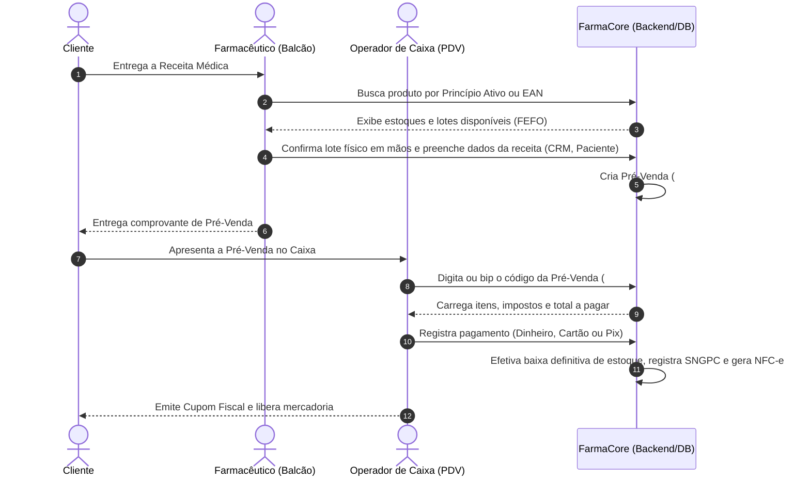

# Documento de Design Final: FarmaCore ERP & PDV
**Data:** 31/10/2026  
**Status:** Aprovado para Planejamento  
**Inspiração / Benchmarking:** InovaFarma (Sistemas de Gestão e Frente de Caixa para Varejo Farmacêutico)

---

## 1. Contexto e Motivação
O varejo farmacêutico no Brasil opera sob um dos regimes regulatórios e tributários mais complexos do mundo. O FarmaCore replica a arquitetura e fluxos de sistemas consagrados como o InovaFarma, unindo:
1. **Fluxo Segregado de Balcão e Caixa:** Atendimento farmacêutico no balcão com geração de Pré-Venda e checkout ágil no Caixa.
2. **Conformidade Regulatória Rigorosa:** Controle de substâncias sob a Portaria 344/98 e RDC 20/2011 da Anvisa, integração com o SNGPC e respeito aos tetos de preços da CMED (PMC/PF).
3. **Gestão Inteligente de Estoque:** Rastreamento estrito de Lote e Data de Validade com algoritmo FEFO (*First Expired, First Out*) e confirmação manual obrigatória para medicamentos controlados.
4. **Alta Performance e Resiliência no PDV:** Operação ágil de frente de caixa com suporte a emulação de periféricos (ESC/POS) e motor fiscal estruturado.

---

## 2. Metas, Não-Metas e Anti-Metas

### Metas (Goals)
* **G1 - Catálogo Especializado:** Cadastro com EAN-13, registro MS, princípio ativo (DCB), classificação de tarja (Livre, Vermelha, Preta), tipo de receituário e tabela CMED (PMC/PF).
* **G2 - Controle de Lotes & FEFO:** Rastreabilidade completa de cada unidade por lote e validade, com sugestão automática do lote mais próximo do vencimento e seleção/confirmação manual obrigatória para antimicrobianos e controlados.
* **G3 - Módulo de Balcão (Pré-Venda):** Tela especializada para atendentes e farmacêuticos consultarem estoque, adicionarem itens, registrarem dados de receitas e gerarem tickets de pré-venda.
* **G4 - Frente de Caixa (PDV):** Interface ultra-rápida operável via teclado/leitor de código de barras para resgatar a Pré-Venda ou vender itens OTC diretos, gerenciar sangrias, suprimentos e formas de pagamento.
* **G5 - Módulo SNGPC:** Geração automática do livro de receituário e exportação de arquivos XML no padrão oficial exigido pela Anvisa.
* **G6 - Motor Fiscal e Tributário:** Cálculo de ICMS-ST, PIS/COFINS (Monofásico, Lista Positiva/Negativa/Neutra) e geração de payload de NFC-e (modelo 65).
* **G7 - Entrada por XML de Fornecedor:** Leitura de NF-e de distribuidoras farmacêuticas com auto-cadastro de lotes e atualização de estoque.

### Não-Metas (Non-Goals)
* Conexão ativa com o ambiente de produção da SEFAZ (exige Certificado Digital A1 de CNPJ ativo pago); forneceremos o motor de assinatura, validação de schema XML e contingência em ambiente de homologação/simulação.
* Contratos comerciais ativos com autorizadores PBM (epharma, Vidalink); forneceremos os adaptadores e contratos de interface (`IPbmProvider`) com mock funcional de autorização de descontos.

### Anti-Metas (Anti-Goals)
* **Nunca** permitir a venda de um item com valor superior ao PMC (Preço Máximo ao Consumidor) estipulado pela CMED.
* **Nunca** permitir que um lote vencido seja faturado no PDV ou Balcão.
* **Nunca** dispensar um medicamento controlado (Portaria 344/98) sem registrar os dados do prescritor, do paciente e do comprador, além de confirmar o lote físico.

---

## 3. Fluxo Operacional Farmacêutico

---

## 4. Decisões de Arquitetura e Engenharia

* **Stack:** TypeScript Full-Stack (Fastify no backend, SQLite como banco relacional local, React + Tailwind no frontend).
* **Emulador de Hardware:** Emulador integrado no frontend para simular impressora de bobina térmica 80mm (ESC/POS) com visualização em tempo real e leitor de código de barras virtual.
* **Topologia de Banco:** SQLite local com suporte a conexões de rede local (LAN), permitindo que múltiplos computadores na loja acessem a retaguarda, o balcão e o caixa. Modelagem com `store_id` preparado para expansão multi-loja.

---

## 5. Roteiro de Execução em Fases ("Por Partes")

1. **Fase 1: Fundação do Catálogo Farmacêutico & Estoque com Lotes (FEFO)**
   * Estrutura do banco de dados (Produtos, Lotes, Princípios Ativos, Tabela CMED/Preços).
   * Lógica de entrada de estoque por lote e validação de validade.
2. **Fase 2: Módulo de Balcão (Atendimento & Pré-Venda)**
   * Busca ágil por EAN, Nome Comercial ou Princípio Ativo (DCB).
   * Modal de retenção de receita para medicamentos sob a Portaria 344/98 e antimicrobianos.
   * Geração de ticket de Pré-Venda com reserva de estoque.
3. **Fase 3: Frente de Caixa (PDV) & Finalização de Vendas**
   * Resgate de Pré-Venda ou venda direta de conveniência/OTC.
   * Gestão de turnos de caixa (Abertura, Sangria, Suprimento e Fechamento).
   * Múltiplos meios de pagamento e impressão térmica simulada.
4. **Fase 4: Motor Regulatório (SNGPC) & Fiscal (NFC-e)**
   * Geração do Livro de Registro de Receituário.
   * Exportador oficial de XML para envio ao SNGPC (Anvisa).
   * Motor de cálculo fiscal (PIS/COFINS monofásico, ICMS-ST) e payload NFC-e.
5. **Fase 5: Retaguarda, Compras (XML Distribuidora) & Dashboard**
   * Importação de NF-e (XML) de distribuidoras com auto-alimentação de lotes.
   * Curva ABC de vendas e alerta de medicamentos próximos do vencimento.
